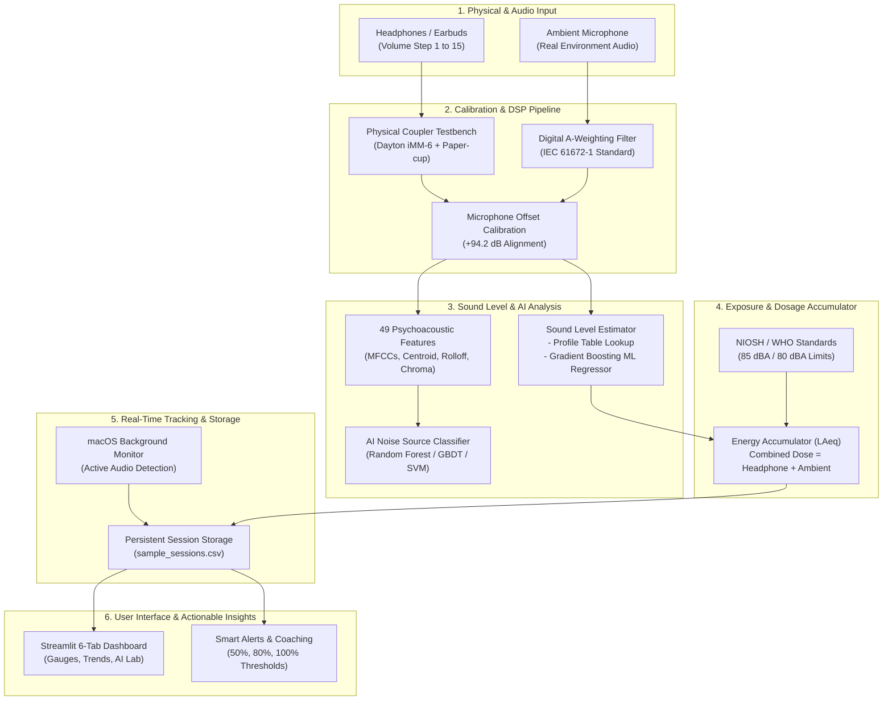
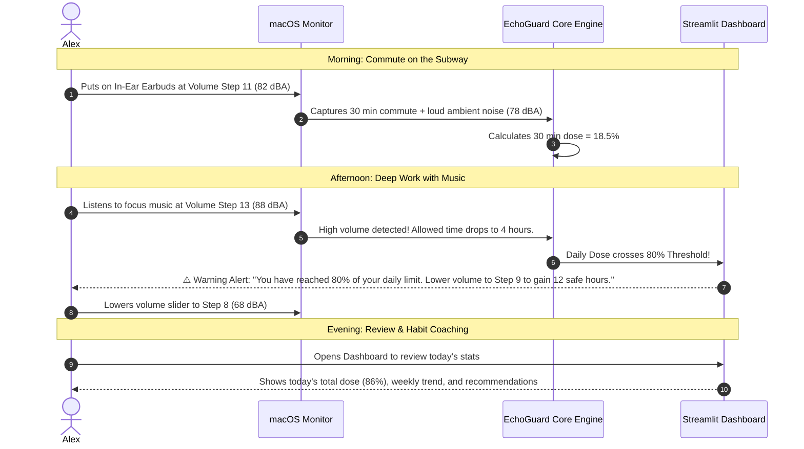

# 🛡️ EchoGuard: Complete Project Workflow & Beginner's Guide

> **A comprehensive, plain-language guide to understanding EchoGuard — what it is, the problem it solves, every feature and its purpose, and how the entire system works from start to finish.**

---

## 📖 Table of Contents
1. [What is EchoGuard?](#1-what-is-echoguard)
2. [What Real-World Problem Does It Solve?](#2-what-real-world-problem-does-it-solve)
3. [Key Features & Why We Use Them](#3-key-features--why-we-use-them)
4. [The Complete End-to-End Workflow](#4-the-complete-end-to-end-workflow)
   - [Visual Architecture Flowchart](#visual-architecture-flowchart)
   - [Phase 1: Physical Coupler & Lab Calibration](#phase-1-physical-coupler--lab-calibration)
   - [Phase 2: Digital Signal Processing (DSP) & A-Weighting](#phase-2-digital-signal-processing-dsp--a-weighting)
   - [Phase 3: Sound Level Estimation (Lookup vs. AI Regressor)](#phase-3-sound-level-estimation-lookup-vs-ai-regressor)
   - [Phase 4: AI Environmental Noise Source Classification](#phase-4-ai-environmental-noise-source-classification)
   - [Phase 5: Cumulative Hearing Dosage & Safety Limits](#phase-5-cumulative-hearing-dosage--safety-limits)
   - [Phase 6: Live macOS Background Monitoring](#phase-6-live-macos-background-monitoring)
   - [Phase 7: Interactive Streamlit Web Dashboard](#phase-7-interactive-streamlit-web-dashboard)
   - [Phase 8: Automated Testing & Verification Suite](#phase-8-automated-testing--verification-suite)
5. [A Day in the Life: How a User Interacts With EchoGuard](#5-a-day-in-the-life-how-a-user-interacts-with-echoguard)
6. [Quickstart: How to Run Every Component](#6-quickstart-how-to-run-every-component)
7. [Glossary of Simple Terms (Cheat Sheet)](#7-glossary-of-simple-terms-cheat-sheet)

---

## 1. What is EchoGuard?

**EchoGuard** is an intelligent personal hearing health system. Think of it like a **"smart fitness tracker for your ears"**. 

Just like a smartwatch tracks your daily steps and warns you if your heart rate is too high, EchoGuard runs on your computer to:
1. **Estimate how loud sound actually is inside your ears** (in decibels / dBA) when you wear headphones.
2. **Listen to ambient background noise** around you (like traffic, construction, or office chatter) and use AI to identify what is making the noise.
3. **Calculate your total daily sound dose** against international safety limits (NIOSH and WHO).
4. **Warn you before you damage your hearing** and coach you with actionable tips to listen safely.

---

## 2. What Real-World Problem Does It Solve?

### The Silent Threat: Noise-Induced Hearing Loss (NIHL)
Over 1 billion young adults worldwide are at risk of permanent, irreversible hearing loss due to unsafe listening habits on headphones and prolonged exposure to loud environments. Hearing damage happens slowly: ear hair cells die without pain, and by the time someone notices ringing (tinnitus) or muffled speech, the damage is permanent.

### The Problems With Existing Devices:
1. **The Volume Slider Myth:** 
   - Your phone or laptop shows a volume slider from `0% to 100%` (or steps `1 to 15`).
   - But **volume percentage does not equal ear sound pressure!** 
   - 70% volume on high-sensitivity in-ear earbuds (like AirPods or Galaxy Buds) can blast over **90 dBA** directly against your eardrum, whereas the same 70% on large studio headphones might only reach **76 dBA**.
   - Operating systems do not know which headphones you are using or how loud they physically sound inside an ear canal.
2. **Ignoring Ambient Noise:**
   - Most people listen to headphones in noisy places (cafes, subways, city streets).
   - In noisy environments, you instinctively crank up the headphone volume to overpower the background noise.
   - Existing apps track *either* headphones *or* ambient noise, but **your ears absorb both**. 
3. **No Clear "Safe Time Left" Clock:**
   - People don't understand decibels because decibels are logarithmic (an 88 dB sound is twice as dangerous as 85 dB).
   - Telling someone *"you are at 88 dBA"* is confusing. Telling them *"at this volume, you have 2 hours and 15 minutes of safe listening left today"* is instantly understandable.

### How EchoGuard Solves This:
- Uses **real empirical lab measurements** of real headphones inside an acoustic coupler testbench.
- Translates volume steps into **calibrated decibel (dBA)** levels.
- Combines **both headphone listening and environmental noise** into a single cumulative daily exposure percentage.
- Uses **AI machine learning** to detect what types of ambient noises surround you.
- Gives you clear, friendly alerts (Green = Safe, Yellow = Caution, Orange = Warning, Red = Limit Exceeded).

---

## 3. Key Features & Why We Use Them

Here is a simple summary of every key feature, why it was built, and the value it provides:

| Feature Name | What It Does | Why We Use It | How It Helps the User |
| :--- | :--- | :--- | :--- |
| **Acoustic Coupler Lab Calibration** | Measures actual sound levels of headphones in a physical sealed test chamber using a calibrated microphone. | Computer volume sliders are unitless numbers. We need real-world ground truth data. | Guarantees that estimated dBA numbers correspond to real acoustic physics, not guesswork. |
| **Digital A-Weighting Filter (IEC 61672-1)** | Filters raw microphone sound frequencies to match human ear sensitivity (ears hear 2–4 kHz best, low bass less). | Raw sound amplitude does not reflect how loud sound feels or damages human hearing. | Ensures sound levels accurately represent actual biological risk to the human ear. |
| **Dual-Mode Level Estimator** | Estimates ear sound level using either a calibrated lookup table or a trained AI Gradient Boosting Regressor. | Provides fast lookup for known devices and smart ML prediction for unknown volume settings/devices. | Gives instant ear-canal dBA readings without needing expensive lab gear connected all the time. |
| **NIOSH & WHO Exposure Dosage Models** | Calculates allowed daily listening time based on scientific standards (NIOSH 85 dBA REL / WHO 80 dBA). | Ear damage depends on both **loudness AND duration** (e.g., 85 dBA for 8 hours = 100% dose). | Tells you exactly what percentage of your safe daily acoustic budget you have consumed. |
| **Unified Headphone + Ambient Engine** | Logarithmically merges headphone sound exposure and ambient noise exposure into a unified $L_{\text{Aeq}}$ and combined dose. | Your ears don't separate sounds — they take the cumulative impact of everything you hear throughout the day. | Prevents false sense of security; accounts for loud subways or street noise on top of music. |
| **AI Noise Source Classifier** | Classifies background sounds into categories (e.g., traffic, barking dogs, sirens, music, jackhammers, air conditioning). | Knowing the noise source helps determine whether noise is continuous, impulsive, or avoidable. | Helps you understand which environments contribute most to your hearing fatigue. |
| **UrbanSound8K 10-Fold Benchmark** | Implements the official 10-fold cross-validation on 8,732 audio samples across 10 environmental classes. | Prevents data leakage and ensures AI classification accuracy is scientifically validated and peer-comparable. | Confirms the AI is accurate on real-world sounds and not just memorizing training examples. |
| **Live macOS Background Monitor** | A lightweight background process that detects active audio (Spotify, YouTube, Zoom, VLC) and logs volume changes. | Users shouldn't have to manually type their volume into a notebook every time they listen to music. | Automatically tracks your listening sessions silently in the background while you work or study. |
| **Interactive Streamlit Dashboard** | A 6-tab web app displaying live gauges, charts, weekly trends, AI playground, and privacy controls. | Provides an intuitive, visual, and engaging interface where anyone can explore their data. | Lets you see your daily hearing health at a glance, test audio files, and manage your data. |
| **Smart Alerts & Habit Coaching** | Generates friendly notifications at 50%, 80%, and 100% daily dose with tips to lower volume or take breaks. | Punitive warnings don't work; constructive habit coaching helps build healthy long-term routines. | Promotes better hearing habits without annoying or judging the user. |

---

## 4. The Complete End-to-End Workflow

Below is the step-by-step lifecycle of how data moves through EchoGuard, from physical sound waves to interactive insights.

### Visual Architecture Flowchart



---

### Phase 1: Physical Coupler & Lab Calibration
*Lead Role: Data & Calibration Lead (Role 2)*

1. **Why do we need calibration?**
   - A digital audio file has values between `-1.0` and `+1.0` (dBFS = decibels full scale).
   - This has no direct link to physical air pressure until we measure it against a known standard.
2. **Building the Testbench:**
   - We constructed a physical sealed acoustic coupler chamber (~15 cm³ volume) using a standardized acoustic cup.
   - We placed a calibrated reference condenser microphone (**Dayton Audio iMM-6**) sealed at one end and the earphone sealed at the other.
3. **Determining the Offset (+94.2 dB):**
   - We played steady pink noise and cross-compared the microphone's raw recording with a calibrated decibel meter.
   - The digital-to-acoustic offset was calculated as:
     $$\text{Offset} = \text{Reference dBA} - \text{Raw dBFS} = +94.2\text{ dB}$$
4. **Recording the Response Curves:**
   - We recorded **135 distinct measurements** across 15 discrete smartphone volume steps for both over-ear headphones (Sony WH-1000XM4) and in-ear monitors (Samsung Galaxy Buds FE).
   - We tested 4 standard signals: pure 1 kHz tone, broadband pink noise, and two dynamic musical tracks.
5. **Repeatability Verification:**
   - We physically took the headphones off the coupler and repositioned them 5 times at low, medium, and high volume to measure real-world variation ($\sigma = 0.58\text{ dB}$ to $1.37\text{ dB}$).
   - The resulting calibration data was saved into `data/calibration.csv` and summarized in `data/headphone_profiles.csv`.

---

### Phase 2: Digital Signal Processing (DSP) & A-Weighting
*Lead Role: Tech Lead (Role 1)*

1. **IEC 61672-1 Digital A-Weighting (`src/audio_level.py`):**
   - The human ear is not equally sensitive to all audio frequencies. It is extremely sensitive to speech frequencies (1 kHz – 4 kHz) and much less sensitive to deep bass (50 Hz) or ultra-high treble (16 kHz).
   - We implemented a digital bilinear transform A-weighting filter. It attenuates frequencies that don't harm human ears and emphasizes the frequencies that cause acoustic trauma.
2. **Calculating Calibrated dBA:**
   - The raw audio signal is filtered through the A-weighting filter to produce $y_A$.
   - The Root Mean Square (RMS) energy is computed:
     $$\text{RMS}(y_A) = \sqrt{\frac{1}{N}\sum_{i=1}^N y_A[i]^2}$$
   - The final sound pressure level is calculated as:
     $$\text{dBA} = 20 \log_{10}(\text{RMS}(y_A)) + 94.2\text{ dB}$$
   - If the audio signal exceeds 99% of maximum digital amplitude ($0.99$), the system flags an audio clipping warning.

---

### Phase 3: Sound Level Estimation (Lookup vs. AI Regressor)
*Lead Role: Tech Lead (Role 1) & ML Lead (Role 3)*

When the user is listening to music on their laptop, we need to know the ear-canal sound level without requiring them to keep a physical microphone plugged into their ears. EchoGuard uses a **Dual-Mode Level Estimator** (`src/level_estimator.py`):

1. **Mode A — Profile Lookup (Default):**
   - Checks `data/headphone_profiles.csv` for the selected headphone model.
   - Reads the current volume step (1 to 15).
   - Uses linear interpolation if the volume falls between steps.
   - Fast, deterministic, and backed directly by empirical lab data.
2. **Mode B — Machine Learning Acoustic Level Regressor:**
   - A trained **Gradient Boosting Regressor** (`models/acoustic_level_regressor.joblib`).
   - Takes features like volume step, headphone type, frequency characteristics, and signal dynamic range to predict the resulting dBA level.
   - Useful for generalizing to non-standard volume increments and different listening configurations.

---

### Phase 4: AI Environmental Noise Source Classification
*Lead Role: Machine Learning & AI Lead (Role 3)*

EchoGuard doesn't just measure how loud the world is; it understands **what** is making the noise (`src/noise_classifier.py` and `src/urbansound8k_benchmark.py`).

1. **49-Dimensional Psychoacoustic Feature Extractor:**
   From any incoming audio snippet (ambient microphone or uploaded WAV file), EchoGuard extracts 49 descriptive acoustic features:
   - **MFCCs (Mel-Frequency Cepstral Coefficients 1–13):** 13 means + 13 standard deviations = 26 features capturing timbre and spectral envelope.
   - **Spectral Centroid (mean & std):** Measures the "brightness" or center of mass of the sound.
   - **Spectral Rolloff (mean & std):** Frequency below which 85% of spectral energy lies.
   - **Spectral Bandwidth (mean & std):** The spread of frequencies in the sound.
   - **Zero Crossing Rate (mean & std):** How rapidly the sound waveform oscillates (identifies percussive vs. tonal sounds).
   - **Chroma Vectors (12 pitch classes):** Energy distribution across musical semitones.
   - **Temporal Crest Factor:** Ratio of peak amplitude to RMS level (differentiates sudden gunshots/horns from continuous engine hums).
2. **Multi-Model Benchmark:**
   - Evaluated 4 distinct classification models: **Random Forest**, **Gradient Boosting (GBDT)**, **Support Vector Machines (SVM)**, and **K-Nearest Neighbors (KNN)**.
   - Random Forest achieved top balance of accuracy, generalization, and sub-millisecond inference speed.
3. **UrbanSound8K 10-Fold Benchmark:**
   - Benchmarked against the gold-standard UrbanSound8K dataset (8,732 sound clips across 10 classes: *air conditioner, car horn, children playing, dog bark, drilling, engine idling, gunshot, jackhammer, siren, street music*).
   - Followed the official 10-fold cross-validation standard (ensuring no data leakage across folds).
   - Generates a cumulative 10x10 confusion matrix and fold-by-fold accuracy tracking.

---

### Phase 5: Cumulative Hearing Dosage & Safety Limits
*Lead Role: Tech Lead (Role 1)*

Loud sound damages hearing through **cumulative acoustic energy over time**. Listening to 85 dBA for 8 hours causes the same acoustic fatigue as listening to 88 dBA for 4 hours, or 91 dBA for 2 hours.

EchoGuard implements two international safety standards (`src/dose_calculator.py`):

1. **NIOSH Standard (National Institute for Occupational Safety and Health):**
   - Recommended Exposure Limit (REL): **85 dBA for 8 hours**.
   - Exchange Rate: **3 dB** (every 3 dB increase cuts safe time in half).
   - Allowed time formula:
     $$T_{\text{allowed}} = \frac{8}{2^{(L - 85)/3}} \text{ hours}$$
2. **WHO-ITU Standard (World Health Organization / International Telecommunication Union):**
   - Weekly baseline limit: **80 dBA for 40 hours/week** (daily budget = 80 dBA for 1.6 hours/day if allocated across a 5-day week).
3. **Calculating Daily Dose Percentage:**
   - For any listening session of duration $t$ hours at sound level $L$:
     $$\text{Dose \%} = \frac{t}{T_{\text{allowed}}} \times 100$$
4. **Logarithmic Energy Accumulation ($L_{\text{Aeq}}$):**
   - You cannot simply average decibels with normal math because decibels are logarithmic.
   - EchoGuard calculates the Equivalent Continuous Sound Level ($L_{\text{Aeq}}$):
     $$L_{\text{Aeq}} = 10 \log_{10}\left( \frac{1}{\sum t_i} \sum t_i \cdot 10^{L_i / 10} \right)$$
5. **Unified Headphone + Ambient Dose:**
   - The total daily dose is the combined sum of both sources:
     $$D_{\text{total}} = D_{\text{headphone}} + D_{\text{ambient}}$$
   - If your headphone dose is 60% and your ambient noise dose is 45%, your total dose is **105%** (Limit Exceeded!).

---

### Phase 6: Live macOS Background Monitoring
*Integration & Real-Time Tracking*

To make EchoGuard effortless to use every day, it includes a background monitoring service (`monitor_laptop.py` and `src/laptop_monitor.py`):

1. **CoreAudio Volume Tracking:**
   - Queries the macOS system volume via AppleScript / CoreAudio APIs.
   - Normalizes volume to the standard 15-step scale.
2. **Media Playback Assertions:**
   - Detects whether audio is actively playing through apps like **Spotify**, **Apple Music**, **YouTube / Web Browsers**, **Zoom**, or **VLC**.
   - Only counts exposure time when audio is *actively* playing through headphones.
3. **Terminal HUD (Heads-Up Display):**
   - Displays a clean real-time status line in the terminal:
     ```text
     [EchoGuard Live] 🟢 Volume: Step 8/15 | Ear Level: 68.6 dBA | Safe Time Left: 36h 24m | Today Dose: 14.2%
     ```
4. **Session Persistence:**
   - Periodically saves sessions into `data/sample_sessions.csv`.
   - Records session start time, duration, headphone model, volume step, calculated dBA, and ambient sound level.

---

### Phase 7: Interactive Streamlit Web Dashboard
*User Experience & Coaching*

The Streamlit web app (`app/app.py`) provides a visual dashboard divided into 6 intuitive tabs:

```text
┌────────────────────────────────────────────────────────────────────────┐
│  🛡️ EchoGuard: Personal Hearing Health Dashboard                      │
├───────────┬───────────┬───────────┬───────────┬───────────┬────────────┤
│  Tab 1    │  Tab 2    │  Tab 3    │  Tab 4    │  Tab 5    │  Tab 6     │
│  Today's  │  Live Ear │  Weekly   │  AI Noise │  Lab      │  Session   │
│  Exposure │  Simulator│  Trends   │  Classify │  Calib.   │  Logger    │
└───────────┴───────────┴───────────┴───────────┴───────────┴────────────┘
```

1. **Tab 1: Today's Exposure & Live Status:**
   - Visual gauge chart displaying current daily dose percentage.
   - Side-by-side KPI cards showing Headphone Dose, Ambient Dose, and Combined $L_{\text{Aeq}}$.
   - Smart alert boxes with color-coded safety warnings (Safe, Moderate, Warning, Danger).
2. **Tab 2: Live Volume & Ear Simulator:**
   - Interactive volume slider (Step 1 to 15) and headphone selector.
   - Shows predicted dBA inside the ear and how many safe hours/minutes you can listen at that setting.
   - Renders a 50 ms simulated audio waveform.
3. **Tab 3: Weekly Trends & Habit Insights:**
   - 7-day stacked bar chart breaking down daily doses into headphone vs. ambient exposure.
   - Identifies listening patterns (e.g., *"Your loudest listening occurs on Thursday afternoons"*).
   - Habit coaching recommendations based on NIOSH and WHO guidelines.
4. **Tab 4: AI Noise Classifier & Acoustic ML:**
   - Upload any audio clip or pick a pre-loaded test sound.
   - Renders interactive probability distribution across all noise categories.
   - Displays model comparison benchmarks, confusion matrix, and feature importances.
5. **Tab 5: Lab Calibration & Profiles:**
   - Explore the real 135 empirical measurement data points from our acoustic chamber experiment.
   - Interactive plots comparing Sony over-ear vs. Samsung in-ear response curves.
   - Repeatability error bars and scientific measurement uncertainty notes ($\pm 5\text{ dB}$).
6. **Tab 6: Session Logger & Privacy:**
   - Log listening sessions manually if monitoring is disabled.
   - Export your entire session history to CSV.
   - One-click local data clearing (100% on-device privacy — no audio or personal data is ever sent to the cloud).

---

### Phase 8: Automated Testing & Verification Suite
*Quality Assurance & Reliability*

EchoGuard includes a comprehensive suite of **22 automated unit tests** (`tests/`) using `pytest`:
- `test_audio_level.py`: Verifies IEC 61672-1 digital A-weighting math, RMS calculations, offset application, and clipping detection.
- `test_dose_calculator.py`: Verifies NIOSH & WHO allowed time formulas, 3 dB exchange rates, combined dosage math, and logarithmic $L_{\text{Aeq}}$ energy averages.
- `test_headphone_profiles.py`: Verifies lookup table loading, volume range validation, and linear interpolation between steps.
- `test_level_estimator.py`: Verifies dual-mode level estimation (profile lookup vs. ML regressor).
- `test_noise_classifier.py`: Verifies 49-feature extraction, synthetic sound generation, model loading, and probability output ranges.
- `test_session_tracker.py`: Verifies daily dose aggregation, session enrichment, and file handling.

---

## 5. A Day in the Life: How a User Interacts With EchoGuard

To see how everything comes together, consider a typical day for a student or engineer named Alex:



1. **8:30 AM — Commute on the Train:**
   - Alex wears Samsung Galaxy Buds FE on the noisy subway.
   - Alex turns the volume up to Step 11 to hear over the train rumbling.
   - EchoGuard notes: Ear level is 82 dBA; ambient train noise is 78 dBA.
   - In 30 minutes, Alex uses **18.5%** of their daily safe sound budget.
2. **2:00 PM — Deep Focus Work at the Desk:**
   - Alex switches to Sony WH-1000XM4 over-ear headphones and cranks music to Volume Step 13 (86.5 dBA).
   - After 2 hours, the macOS background monitor logs the session.
   - EchoGuard's dosage engine recalculates the cumulative dose: **82% of safe daily limit reached!**
3. **4:15 PM — Smart Alert Triggers:**
   - EchoGuard triggers an alert:
     > *"⚠️ Attention: You have reached 82% of your safe daily exposure limit. At current volume (Step 13), you have only 42 minutes of safe listening remaining today. Lowering volume by just 2 steps (to Step 11) will give you 3 additional hours of safe listening!"*
   - Alex turns the volume down to Step 9 (70.5 dBA). The risk drops drastically.
4. **7:00 PM — Evening Dashboard Review:**
   - Alex opens the Streamlit Dashboard.
   - Tab 1 confirms today's total dose stayed at **89% (Safe!)**.
   - Tab 3 shows that Alex's average daily dose has decreased by 15% compared to last week.

---

## 6. Quickstart: How to Run Every Component

All commands can be run directly from your terminal in the project directory:

### 1. Set Up the Python Environment
```bash
# Create and activate a clean virtual environment
python3 -m venv .venv
source .venv/bin/activate

# Install all project dependencies
pip install -r requirements.txt
```

### 2. Run the Automated Tests (Pytest)
Verify that all mathematical formulas, DSP filters, and ML models are working perfectly:
```bash
pytest
```
*(All 22 unit tests will run and pass in ~3-5 seconds.)*

### 3. Launch the Interactive Web Dashboard
Run the 6-tab Streamlit web application:
```bash
streamlit run app/app.py
```
*Open your browser and navigate to `http://localhost:8501`.*

### 4. Run the Live macOS Monitor Daemon
Start real-time volume and media playback monitoring on your Mac:
```bash
python monitor_laptop.py
```
*Leave it running in a terminal tab while you work or listen to music.*

### 5. Run the 60-Second Acoustic Calibration Demo
See the calibrated coupler estimation in action from the command line:
```bash
python scripts/demo_calibration.py --step 10 --signal tone1k
```

### 6. Train the AI Models & Rebuild Benchmark Charts
Re-run multi-model benchmarking (Random Forest, GBDT, SVM, KNN) and generate high-res plots:
```bash
python scripts/train_noise_classifier.py
```
*Benchmark charts will be saved directly into `docs/figures/`.*

---

## 7. Glossary of Simple Terms (Cheat Sheet)

If you are new to audio engineering or artificial intelligence, here is a quick reference guide:

| Term | What It Means in Simple Words |
| :--- | :--- |
| **dB (Decibel)** | A logarithmic unit used to measure sound loudness. A 10 dB increase sounds about twice as loud to human ears. |
| **dBA (A-Weighted Decibels)** | Decibels adjusted to reflect how the human ear actually hears. Low bass frequencies that don't harm hearing are de-emphasized. |
| **dBFS (Decibels Full Scale)** | Digital sound levels inside a computer, where `0 dBFS` is the absolute loudest possible digital signal before distortion/clipping. |
| **RMS (Root Mean Square)** | A mathematical way to calculate the average continuous energy of an audio wave over time. |
| **$L_{\text{Aeq}}$ (Equivalent Continuous Sound Level)** | The steady sound level that would contain the exact same acoustic energy as a varying sound level over a given time period. |
| **Acoustic Coupler** | A small, airtight physical chamber used in laboratory experiments to attach an earphone to a measurement microphone, mimicking an ear canal cavity. |
| **NIOSH Limit (85 dBA)** | The United States workplace standard: 85 dBA is safe for a maximum of 8 hours per day. Every 3 dB increase halves the safe time (88 dBA = 4 hours). |
| **WHO Limit (80 dBA)** | The World Health Organization guideline for recreational listening: 80 dBA for up to 40 hours per week. |
| **Daily Dose (%)** | The percentage of your safe daily acoustic energy budget you have consumed so far today. 100% means you should rest your ears. |
| **MFCCs (Mel-Frequency Cepstral Coefficients)** | Mathematical representation of the unique "texture" or "timbre" of a sound, widely used in speech and noise recognition AI. |
| **UrbanSound8K** | A famous public dataset of 8,732 real-world audio recordings across 10 environmental noise categories used to train and test noise classifiers. |

---

## 🎓 Summary

EchoGuard bridges the gap between **physical acoustic laboratory measurements**, **digital signal processing**, **machine learning classification**, and **practical user software**. It turns confusing volume sliders into scientifically grounded hearing protection, helping people enjoy music and media without sacrificing their lifelong hearing.
